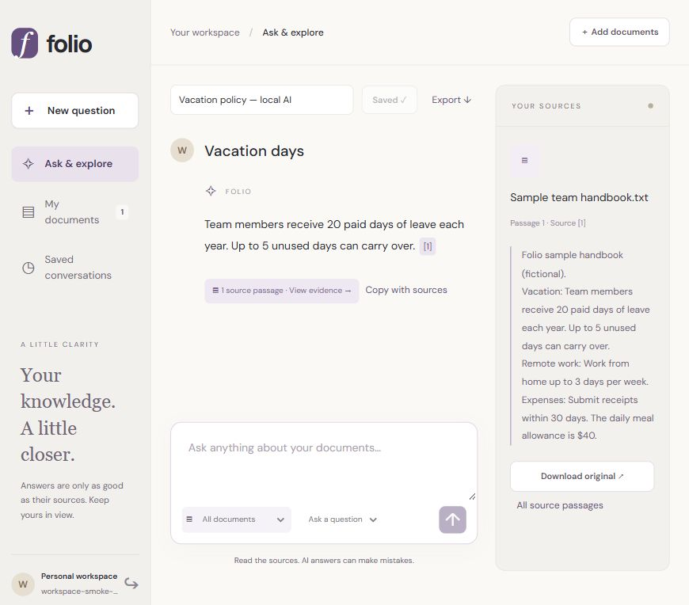

# Folio — Your knowledge, connected

A document workspace with local AI answers, clickable source passages, saved conversations, and project collections.

## What works today

- Upload PDF, text, and Markdown documents; track preparation and preview extracted passages.
- Ask questions with cited answers from a locally hosted model, or search original passages directly.
- Summarize selected document excerpts and explore topics with bounded research workflows.
- Organize documents into private collections and limit questions to a collection or document.
- Save conversations to your account, reopen them, copy answers with sources, and export Markdown.
- Account isolation protects documents, collections, retrieval results, and saved conversations.



## Run locally

See [LOCAL_DEVELOPMENT.md](LOCAL_DEVELOPMENT.md) for prerequisites and configuration. From the project directory on Windows, run these in separate terminals:

```powershell
.\scripts\Run-Backend.ps1
.\scripts\Run-Frontend.ps1
```

The frontend runs at http://127.0.0.1:5174. For local AI, run `scripts/Enable-LocalAI.ps1` once and restart the backend. This downloads Ollama and a local model; no paid API key is needed. Credentials are generated in the ignored `.env.local` and are never part of this repository.

## Verification and limits

The backend suite passed **71 tests** locally; frontend build and lint passed. Browser checks covered local answers, cited sources, save/reopen/export, collection creation, document movement, and scoped search. Live checks used a fictional handbook. This is a local product prototype, not a production deployment or a broad answer-quality benchmark. Local generation took roughly 12–51 seconds on the development computer. Retrieval currently uses keyword search locally; optional vector retrieval requires separately configured embeddings. Summaries cover selected excerpts, and new questions do not use saved conversation history as model memory.

See [PROJECT_SPEC.md](PROJECT_SPEC.md), [WORK_LOG.md](WORK_LOG.md), and [evaluation/README.md](evaluation/README.md) for scope and test evidence. The original brief is in [PROJECT_IDEA_ORIGINAL.txt](PROJECT_IDEA_ORIGINAL.txt).

## What GitHub stores

This repository stores source code, tests, migrations, scripts, documentation, and sample verification artifacts. It excludes credentials, runtime logs, dependency/build folders, uploaded documents, database contents, and downloaded AI models. Those remain local; GitHub is not a backup of workspace data.

---

## Architecture

A **modular monolith**. One deployable Spring Boot service organized into
feature packages (`auth`, `user`, `admin`, `audit`, `security`, `system`,
`document`, `search`, and `rag`) plus a `common` layer for
cross-cutting concerns. This keeps local development and operations simple while
preserving clean module boundaries that could be split into services later if
ever justified.

Key decisions:

- **PostgreSQL does double duty.** pgvector provides semantic vector search and
  Postgres full-text search provides lexical search, fused later via Reciprocal
  Rank Fusion — avoiding a second search engine (OpenSearch/Elastic) for this
  scale. Redis is used for caching and ephemeral state.
- **Stateless authentication.** Identity travels in a signed JWT, so the API
  holds no server-side session. Refresh tokens are persisted (hashed) to support
  rotation and revocation.
- **Flyway owns the schema.** Every change is a versioned migration
  (`V1__baseline.sql`, `V2__auth.sql`, ...); Hibernate only validates.
- **Config is environment-driven** (12-factor): one `application.yml` with
  sensible localhost defaults, every value overridable by an env var, so the
  same artifact runs locally, in Docker and in the cloud.
- **Errors and logs are uniform.** A single `ApiError` shape for every failure
  and a correlation id threaded through logs and responses.

```
Browser (React SPA)
   │  /api, /actuator  (Vite proxy in dev · nginx reverse-proxy in Docker)
   ▼
Spring Boot API  ──►  PostgreSQL + pgvector   (data, vectors, audit)
   │              ──►  Redis                    (cache)
   │              ──►  MinIO (S3 API)           (object storage, used from Phase 3)
   ▼
JWT auth · RBAC · Flyway · Actuator · OpenAPI
```

---

## Monorepo structure

```
enterprise-knowledge-platform/
├── backend/                       # Spring Boot 3 service (Java 17, Maven)
│   ├── src/main/java/com/ekp/
│   │   ├── EkpApplication.java
│   │   ├── common/                # error handling, correlation-id filter
│   │   │   ├── error/             # ApiError, GlobalExceptionHandler, exceptions
│   │   │   └── web/               # CorrelationIdFilter
│   │   ├── config/                # OpenAPI, CORS
│   │   ├── security/              # SecurityConfig, JWT service/filter, principals,
│   │   │                          #   entry-point & access-denied handlers
│   │   ├── auth/                  # controller, service, refresh-token service, DTOs
│   │   ├── user/                  # User entity, Role, repository
│   │   ├── admin/                 # ADMIN-only controller (RBAC demo)
│   │   ├── audit/                 # append-only audit log
│   │   ├── bootstrap/             # AdminSeeder (first admin from config)
│   │   └── system/                # public /system/ping
│   ├── src/main/resources/
│   │   ├── application.yml        # env-driven config
│   │   ├── logback-spring.xml     # readable locally, JSON in containers
│   │   └── db/migration/          # Flyway: V1 baseline, V2 auth
│   ├── src/test/                  # Testcontainers smoke + auth integration tests
│   ├── Dockerfile                 # multi-stage, non-root
│   ├── pom.xml
│   └── mvnw, mvnw.cmd, .mvn/       # Maven wrapper
│
├── frontend/                      # React 18 + TypeScript + Vite + Tailwind
│   ├── src/
│   │   ├── api/                   # client (timeout, refresh-on-401), system, auth
│   │   ├── auth/                  # AuthContext (session bootstrap, refresh)
│   │   ├── components/            # LoginPage, StatusCard
│   │   ├── App.tsx                # auth gating + console + RBAC probe
│   │   └── main.tsx
│   ├── Dockerfile                 # build + nginx
│   ├── nginx.conf                 # SPA fallback + reverse proxy
│   └── package.json, vite/ts/tailwind configs
│
├── infra/
│   ├── docker-compose.yml         # postgres, redis, minio, backend, frontend
│   ├── .env.example               # single source of stack config
│   └── postgres/init/             # enable pgvector on first boot
│
├── .github/workflows/             # backend-ci (Maven + Testcontainers), frontend-ci
└── README.md
```

---

## Prerequisites

- **Docker Desktop** (or Docker Engine + Compose v2) — for the full stack.
- For the fast dev loop in VS Code: **JDK 17+** and **Node 20+**.
- VS Code extensions: *Extension Pack for Java*, *ESLint*, *Tailwind CSS
  IntelliSense*, *Docker*.

---

## Environment variable strategy

Configuration is layered and never hard-coded:

1. **`backend/src/main/resources/application.yml`** declares every setting with a
   localhost default and an env-var override, e.g.
   `url: jdbc:postgresql://${DB_HOST:localhost}:${DB_PORT:5432}/${DB_NAME:ekp}`.
2. **`infra/.env`** (copied from `infra/.env.example`) is the single source of
   truth for the Docker Compose stack — DB credentials, MinIO keys, the JWT
   secret, admin-seed credentials, ports. Compose injects these into the backend
   container as env vars. **`.env` is gitignored; only `.env.example` is committed.**
3. **`frontend/.env.example`** documents `VITE_*` browser variables. The SPA
   calls relative paths (`/api`, `/actuator`) by default, so usually nothing needs
   setting.

Before running with Docker:

```bash
cd infra
cp .env.example .env
# Edit .env: set a strong JWT_SECRET (e.g. `openssl rand -base64 48`)
# and ADMIN_EMAIL / ADMIN_PASSWORD to bootstrap the first admin.
```

---

## Running the whole stack (Docker Compose)

```bash
cd infra
cp .env.example .env      # first time only; then edit secrets
docker compose up --build
```

| Service        | URL                              |
| -------------- | -------------------------------- |
| Frontend       | http://localhost:3000            |
| Backend API    | http://localhost:8080            |
| Swagger UI     | http://localhost:8080/swagger-ui.html |
| Health         | http://localhost:8080/actuator/health |
| MinIO console  | http://localhost:9001            |
| PostgreSQL     | localhost:5432                   |
| Redis          | localhost:6379                   |

Compose starts dependencies first, waits for Postgres and Redis to report
**healthy**, then starts the backend, then the frontend. Stop with `Ctrl+C`;
`docker compose down -v` also removes the data volumes.

---

## Running locally in VS Code (fast dev loop)

Run only the infrastructure in Docker and the apps natively for instant reloads.

**1. Start infra only:**

```bash
cd infra
cp .env.example .env      # first time only
docker compose up -d postgres redis minio minio-init
```

**2. Backend (Spring Boot):** open the repo in VS Code with the Java extension
pack. Run `EkpApplication` (Run/Debug, or `cd backend && ./mvnw spring-boot:run`).
With no env vars set it uses the `application.yml` localhost defaults and connects
to the Docker Postgres/Redis. To bootstrap an admin, set `ADMIN_EMAIL` and
`ADMIN_PASSWORD` (VS Code launch config env, or shell export) before starting.
The API comes up on http://localhost:8080.

**3. Frontend (Vite):**

```bash
cd frontend
npm install
npm run dev
```

Open http://localhost:5173. Vite proxies `/api` and `/actuator` to the backend
on 8080, so there are no CORS concerns and the client code is identical to the
Docker setup.

**Demo the auth flow:** register a new account (created as `USER`) → you land on
the console → click **send request** on the access-control probe and you get
**403** (USER cannot reach `/api/v1/admin/users`). Log out, log in as the seeded
admin, run the probe again → **200**. That is RBAC enforced server-side.

---

## Health checks

- `GET /api/v1/system/ping` — public liveness + build version (used by the SPA).
- `GET /actuator/health` — aggregate health with component details (db, redis,
  disk). Public; `show-details` is `always` for dev convenience and should be set
  to `when_authorized` in production.
- `GET /actuator/health/liveness` and `/readiness` — Kubernetes-style probes
  (the backend container healthcheck uses liveness).
- `GET /actuator/info`, `/actuator/metrics`, `/actuator/prometheus` — metadata
  and metrics (`/actuator/**` beyond health requires `ADMIN`).

---

## Authentication & API summary

| Method & path                 | Access        | Purpose                                   |
| ----------------------------- | ------------- | ----------------------------------------- |
| `POST /api/v1/auth/register`  | public        | Create a `USER` account, returns a session |
| `POST /api/v1/auth/login`     | public        | Authenticate, returns tokens              |
| `POST /api/v1/auth/refresh`   | public        | Rotate refresh token, new access token    |
| `POST /api/v1/auth/logout`    | public        | Revoke a refresh token                    |
| `GET  /api/v1/auth/me`        | authenticated | Current user profile                      |
| `GET  /api/v1/admin/users`    | `ADMIN`       | List users (RBAC demonstration)           |
| `GET  /api/v1/system/ping`    | public        | Liveness + version                        |

Access tokens are short-lived (default 15m) JWTs sent as
`Authorization: Bearer <token>`. Refresh tokens are long-lived (default 30d),
stored **hashed**, and **rotated** on every refresh. Passwords are hashed with
**BCrypt**. The first `ADMIN` is seeded on startup from `ADMIN_EMAIL` /
`ADMIN_PASSWORD`; registration can never grant `ADMIN`.

---

## Testing

```bash
cd backend
./mvnw verify        # context-load smoke test + auth/RBAC integration test
```

Backend tests use **Testcontainers** to start a real `pgvector/pgvector:pg16`
Postgres, so migrations and queries run against the production engine (Docker
must be running). The frontend is validated by `npm run build` (typecheck +
bundle) and `npm run lint`. Both run in CI on every push.

---

## Notes & known constraints

- `package-lock.json` is generated on your first `npm install`; until then the
  Dockerfile and CI fall back to `npm install`.
- A strong `JWT_SECRET` (≥ 32 bytes) is mandatory; the committed default is
  intentionally insecure and for local use only.

## Try the product

Follow the [fictional Northstar Labs demo](demo/WALKTHROUGH.md) to explore collections, cited answers, policy comparisons, honest missing-information responses, and saved exports. See the [local answer-quality report](evaluation/ANSWER_QUALITY.md) for measured results and limitations.
